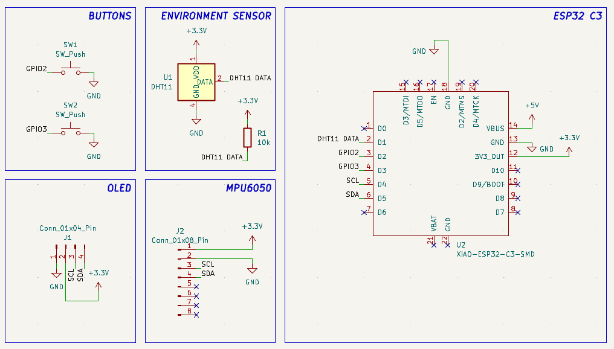
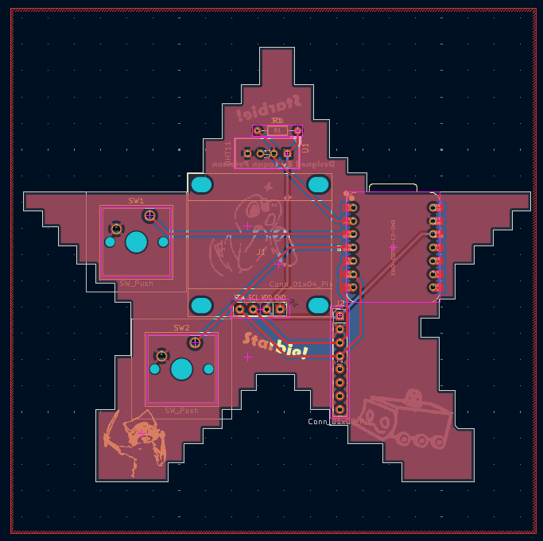

# Starbie

Starbie is a tiny motion-controlled digital pet created as the Week 1 beginner hardware project for [Hack Club Half Life](https://halflife.hackclub.com/). It sits on a desk, shows an animated pet on a 0.96-inch OLED, and reacts when the board is tilted, moved, or shaken.

## How it works

A Seeed Studio XIAO ESP32-C3 drives the display, reads an MPU6050 motion sensor, and optionally reads temperature and humidity from a DHT11. The firmware stores joy, energy, and fullness in the ESP32's non-volatile preferences. Two buttons and a tilt-controlled radial menu provide interaction.

- **Button 1:** open or confirm the radial menu.
- **Button 2:** show or hide the pet stats.
- **Tilt:** move through the radial menu.
- **Shake:** wake and play with the pet.

The default actions are nap, play, feed, and pet. The settings and sprite near the top of the Arduino sketch are intended to be beginner-editable.

## Project visuals

Every image below is committed to this repository, so it renders directly on the GitHub README without relying on an external image host.

### Populated-board CAD assembly

This is a CAD render of the intended finished, exposed-board device. It is not a photograph of a physically soldered build.

### Complete schematic

Editable source: [PCB/Starbie.kicad_sch](PCB/Starbie.kicad_sch)

### Routed PCB layout

Editable source: [PCB/Starbie.kicad_pcb](PCB/Starbie.kicad_pcb)

### PCB front and back

## Hardware

The full parts list is in [BOM.csv](BOM.csv). The main parts are:

- Seeed Studio XIAO ESP32-C3
- 0.96-inch I2C OLED
- MPU6050 motion sensor
- DHT11 temperature/humidity sensor
- Two installed MX switches and keycaps; the purchase BOM includes two spares of each
- One 10 kΩ resistor
- The custom Starbie PCB

The estimated purchase cost is **$26.29 per kit** before shipping and taxes, including the spare switches and keycaps listed in the BOM.

## Build and use

1. Order the PCB using [PCB/production/Starbie Gerbers V1.0.zip](PCB/production/Starbie%20Gerbers%20V1.0.zip).
2. Solder the XIAO ESP32-C3, OLED, MPU6050, DHT11, 10 kΩ resistor, and two MX switches into their labeled PCB footprints. The modules and switches mount through plated holes and are held by their soldered pins.
3. Fit the two keycaps and inspect the board for reversed modules, missed joints, or solder bridges before applying power.
4. Connect the board over USB-C and upload the Arduino sketch using the firmware steps below.
5. Press Button 1 to open or confirm the radial menu, tilt the board to choose an action, and press Button 2 to show or hide the pet stats.

## Firmware

The Arduino sketch is at [Firmware/Starbie/Starbie.ino](Firmware/Starbie/Starbie.ino). Detailed setup and customization notes are in [Firmware/README.md](Firmware/README.md).

Quick start:

1. Install the ESP32 board package in Arduino IDE.
2. Select **XIAO_ESP32C3**.
3. Install Adafruit GFX, Adafruit SSD1306, Adafruit MPU6050, and the DHT sensor library.
4. Open Firmware/Starbie/Starbie.ino.
5. Select the board's serial port and upload.

A browser-based interaction preview is included at [Firmware/simulator.html](Firmware/simulator.html).

## PCB and fabrication

KiCad project sources are in [PCB/](PCB/):

- Starbie.kicad_sch — schematic
- Starbie.kicad_pcb — PCB layout
- Starbie.kicad_pro — KiCad project
- libs/ — project-specific symbols, footprints, and component models

Ready-to-manufacture Gerber and drill files are in [PCB/production/](PCB/production/). Upload Starbie Gerbers V1.0.zip to a PCB manufacturer and review its preview before ordering. The extracted files are included alongside the archive for inspection.

## Complete CAD assembly

**Finished assembly file:** [PCB/Starbie.glb](PCB/Starbie.glb)

The GLB is the complete populated-board CAD assembly for the intended exposed-PCB version of Starbie. The checked model contains:

- the custom Starbie PCB
- the XIAO ESP32-C3
- the 0.96-inch OLED
- the MPU6050 module
- the DHT11 sensor
- the 10 kΩ resistor
- both MX switches and both keycaps

The model and committed render were inspected together to confirm that the intended components are present and placed on the board. The editable render source is [Renders/Starbie.blend](Renders/Starbie.blend), and the assembled-model screenshot is [Renders/Starbie Render.png](Renders/Starbie%20Render.png).

**Assembly scope:** Starbie is designed as an exposed-board desktop device. The assembly does not include an enclosure, battery, USB cable, or physical solder-joint geometry. Those items should not be inferred from the render. The files under [PCB/libs/3D Models/](PCB/libs/3D%20Models/) are individual component STEP models, not the finished assembly. There is currently no single full-assembly STEP export; use the GLB for the complete view and the Blender file for editable assembly/render source.

## External design review

**Status: pending.** [Design review request #1](https://github.com/tarekelbehiry468-commits/Half-Life-Week-/issues/1) is open. No independent human review feedback is currently recorded in this repository, so this requirement must not be marked complete yet.

Before the Forge submission, ask a peer, mentor, or knowledgeable community member to inspect the schematic, routed PCB, BOM, and populated assembly. Useful checks include power and ground, I2C wiring, button inputs, the DHT11 pull-up, footprints and orientation, routing/clearances, placement, assembly collisions, and whether the BOM matches the design.

Record the real review here or in a website devlog entry using this structure:

> **Reviewer:** Name or role, with permission  
> **Reviewed:** Schematic / PCB / assembly  
> **Feedback:** Their actual comments  
> **Changes made:** What changed, or why the design was kept as-is  
> **Verification:** How the response was checked

Do not replace this pending notice with a completed review until someone has actually reviewed the design.

## Devlog note

The Half Life website devlog is the source of truth for this project. [JOURNAL.md](JOURNAL.md) is an automatically generated mirror and states that local edits are overwritten on the next sync, so process-detail improvements should be made in the existing website entries rather than only in that file.

## Repository layout

- Firmware/ — Arduino firmware, instructions, and browser simulator
- PCB/ — KiCad design sources and the complete populated-board GLB
- PCB/production/ — Gerber and drill fabrication outputs
- PCB/libs/3D Models/ — individual component STEP models
- Renders/ — complete assembly render, front/back renders, and Blender source
- GuidePics/ — committed schematic, PCB-layout, and process images
- Week 1 Guide.md and Week 1 Care Package.zip — original design walkthrough and library bundle
- BOM.csv — machine-readable bill of materials
- BOM.md and JOURNAL.md — Half Life platform mirrors

## Source, credit, and license

This repository imports the Starbie design from [SharKingStudios/Starbie](https://github.com/SharKingStudios/Starbie). The original board identifies Logan Peterson as its designer. The imported source is provided under the MIT License; see [LICENSE](LICENSE).

For a Forge-specific gap review, see [FORGE_CHECKLIST.md](FORGE_CHECKLIST.md).
